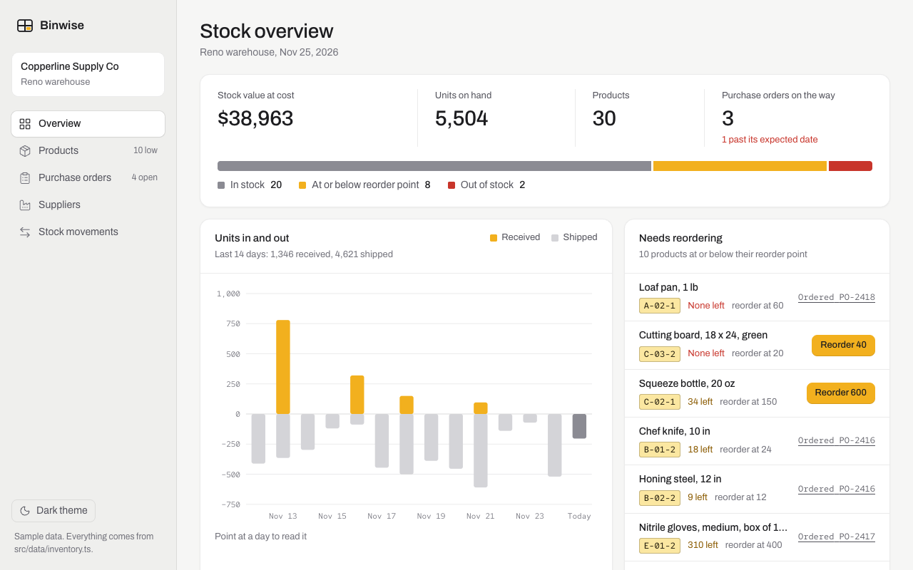

# Binwise: inventory dashboard template

A free React inventory and warehouse dashboard: stock levels with low-stock alerts, a products table, purchase orders you can send and receive, suppliers and a ledger of stock movements. Static, fast and easy to point at your own data. The demo is a fictional restaurant supply warehouse.



[](https://console.cloudzyro.com/new?repo=https://github.com/Cloudzyro/template-inventory-dashboard)

## What's included

- Overview: stock value, units on hand, products and orders on the way; stock health as one bar (in stock, at or below the reorder point, out of stock); units received and shipped per day for 14 days; products that need reordering, with a Reorder button or the order that already covers them; the latest movements
- Products: search by name, SKU or bin, filter by category and stock status (kept in the address), on hand drawn against the reorder point, bin locations, unit cost and value
- Purchase orders: drafts, on the way and received, with due and late dates; an order page with lines, totals, progress and supplier contact
- Reorder adds a product's reorder quantity to its supplier's draft (or starts one); Send moves a draft to ordered; Mark received adds the units to stock and logs each line as a movement
- Suppliers: lead time, on-time rate, products and open orders
- Stock movements: every unit received, shipped, adjusted or moved, grouped by day, filterable by type
- Changes are kept in the browser with localStorage, so the demo feels real without a backend
- Light and dark themes, a sidebar on desktop and a scrolling tab bar on phones
- Hash routing, so every page and deep link works on any static host

## Run it locally

```bash
pnpm install
pnpm dev        # http://localhost:5173
pnpm build      # static site in dist/
pnpm preview    # serve the built site
```

## Make it yours

- **Products, suppliers, purchase orders, movements and the 14-day flow:** `src/data/inventory.ts`. Replace the arrays with calls to your own API when you're ready.
- **Today's date:** the sample treats November 25, 2026 as today (`app.today`). Set it to `null` to use the real date.
- **Saved changes:** `src/lib/store.ts` keeps reorders, sent orders and received stock in localStorage. Swap those functions for API calls to save them for real.
- **Colors:** the CSS variables at the top of `src/index.css` (`:root` for light, `:root.dark` for dark). The accent is `--accent`; the bin label colors are `--label` and `--label-ink`.
- **Fonts:** Archivo and Red Hat Mono, self-hosted through Fontsource and imported in `src/main.tsx`.
- **Pages:** add a page in `src/pages/`, a route in `src/main.tsx` and a link in `src/components/Layout.tsx`.
- **Social card:** replace `public/og-image.png` (1200x630).

Optional build-time variables:

| Variable | What it does |
| --- | --- |
| `VITE_SITE_URL` | Your public address, used for the social card and sitemap |
| `VITE_ALLOW_INDEXING` | Set to `true` to let search engines index the dashboard. Off by default, since inventory dashboards are usually private |

This template has no sign-in. Before you connect real stock, put it behind your own auth (for example Supabase Auth, Clerk or your host's access controls).

## Routing on static hosts

The app uses React Router's hash router, so addresses look like `/#/products?status=out`. The part after `#` never reaches the server, so deep links and refreshes work on any static host with no rewrite rules. The build also writes `dist/404.html`.

## Deploy

Click the **Deploy to Cloudzyro** button above, or push your own copy to GitHub and connect it in the Cloudzyro console. The build command is `pnpm build` and the output folder is `dist`. No server is needed.

## Stack

- [React](https://react.dev) 19 and [React Router](https://reactrouter.com) 8
- [Vite](https://vite.dev) 8
- Plain CSS with custom properties (no CSS framework)
- [Lucide](https://lucide.dev) icons
- TypeScript

## License

MIT, see [LICENSE](./LICENSE).
